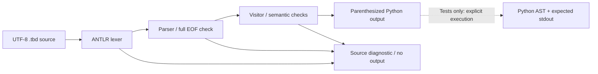

# Tabloid to Python Compiler

A Java and ANTLR source-to-source compiler for a documented **coursework dialect
of Tabloid**, the clickbait-inspired programming language. It translates `.tbd`
programs into readable Python 3 and rejects invalid input before writing output.


This public edition develops supplied university coursework with a corrected
grammar, explicit expression semantics, actionable diagnostics, reproducible
parser generation and **32 automated tests**. All six source-derived examples
are translated, parsed as Python and executed against expected output.

## A small example

Tabloid source:

```text
EXPERTS CLAIM score TO BE 2 PLUS 3 TIMES 4
WHAT IF score BEATS 10
RUMOR HAS IT
    YOU WON'T WANT TO MISS 'Breaking news!'
    YOU WON'T WANT TO MISS score
END OF STORY
PLEASE LIKE AND SUBSCRIBE
```

Generated Python, excluding the generated-file comment:

```python
_t_score = (2 + (3 * 4))
if (_t_score > 10):
    print('Breaking news!')
    print(_t_score)
```

Every source identifier receives the `_t_` prefix, so names such as `class`,
`print` or `input` cannot conflict with Python syntax or the emitted built-ins.
Parentheses preserve the parse tree's grouping rather than relying on Python
to reconstruct it.

## Build and run

Requirements: **JDK 17+** (`java` and `javac` on PATH) and **Python 3.10+**.
No Python packages, Maven or Gradle are required. Run from the repository root.

```text
python tools/build.py
python -m unittest discover -s tests -v
python tools/tabloid.py examples/factorial.tbd -o build/factorial.py
python build/factorial.py
```

Expected program output:

```text
Hello, World!
Result is
3628800
```

The first build downloads ANTLR 4.13.1 from `antlr.org` and verifies its pinned
SHA-256. The same JAR provides generation and runtime support. Later builds can
run with `python tools/build.py --offline`. The downloaded JAR stays in `.cache/`;
it is not included in this repository. If a different Python launcher is used
on Windows, replace `python` with the appropriate launcher consistently.

The compiler **does not execute** generated code. Running the final Python
command is a separate, deliberate action. Inspect unfamiliar source/output first.

## CLI behavior

```text
python tools/tabloid.py examples/arithmetic.tbd
python tools/tabloid.py examples/input.tbd --check
python tools/tabloid.py examples/logic.tbd -o build/logic.py
python tools/tabloid.py examples/logic.tbd -o build/logic.py --force
```

- Without `-o`, Python is written to stdout.
- `--check` parses and performs the implemented semantic checks without emitting.
- Output files require `.py`, and existing files are preserved unless `--force`
  is explicit. Invalid source never overwrites an output, including with `--force`.
- Diagnostics go to stderr with filename and one-based source line/column where
  available. Exit codes are 0 for success, 1 for compilation failure and 2 for
  usage/filesystem/encoding errors.
- The compiler also runs directly via `java -jar build/tabloid-compiler.jar`.
  Keep `.cache/` alongside the repository's `build/` directory; the thin JAR
  references that external runtime dependency.

## Language coverage

| Feature | Supported form |
|---|---|
| Assignment | `EXPERTS CLAIM name TO BE expression` |
| Output / input | `YOU WON'T WANT TO MISS expression` / `LATEST NEWS ON expression` |
| Functions | `DISCOVER HOW TO name WITH parameters ...` |
| Calls | `name OF argument, argument`; zero arguments: `name OF ()` |
| Return | `SHOCKING DEVELOPMENT expression` inside functions |
| Branches | `WHAT IF condition ... LIES! ...`, single statements or blocks |
| Loops | `STAY TUNED WHILE condition` followed by a block |
| Blocks | `RUMOR HAS IT ... END OF STORY`; empty blocks emit `pass` |
| Operators | Arithmetic, comparison, short-circuit AND/OR and unary MINUS |
| Literals | Decimal numbers, escaped single-quoted strings and booleans |
| Comments | `UNCONFIRMED RUMOR:` through the end of a line |
| Terminator | `PLEASE LIKE AND SUBSCRIBE`, followed by end-of-file |

The [language guide](docs/language.md) defines precedence, call boundaries and
Python runtime behavior. This is **not a fully compatible implementation** of
[Linus Lee's original Tabloid](https://github.com/thesephist/tabloid), whose
expression-based design and JavaScript semantics differ from this coursework
dialect. See the explicit compatibility table in the language guide.

## Compiler pipeline



## Explore the project

- [Grammar](grammar/Tabloid.g4) and [visitor emitter](src/main/java/tabloid/PythonEmitter.java).
- [Six examples and their generated Python](examples/README.md).
- [Language and compatibility](docs/language.md).
- [Architecture and design choices](docs/architecture.md).
- [Original defects, provenance and public changes](docs/provenance.md).
- [Verification record](docs/verification.md).
- [GitHub title, description, topics and upload instructions](docs/github-upload.md).

## Limits and attribution

This compiler has no static type checker, definite-assignment analysis,
optimization passes, Python traceback source maps or full upstream conformance
suite. Undefined names, arity errors and invalid runtime operand types are left
to Python. Translated programs are not sandboxed. See [SECURITY.md](SECURITY.md).

Project code is under [MIT](LICENSE). ANTLR retains its own license; the original
Tabloid language is credited separately in [third-party notices](THIRD_PARTY_NOTICES.md).
