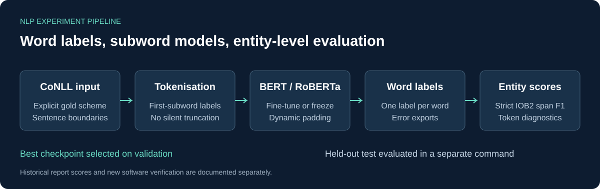

# Named Entity Recognition with BERT on CoNLL-2003

English NLP portfolio project by Spiros Grouztidis. Fine-tune BERT or RoBERTa
for word-level labels, compare cased and uncased models, freeze the encoder,
and extend the same pipeline to POS tagging and text chunking.




**Evidence status:** the original coursework reports 97.2% token accuracy for
BERT uncased and 97.4% for BERT cased. These are historical report values,
not entity F1 scores and not newly reproduced results. The public implementation
adds strict entity-level evaluation and offline integration checks with tiny
randomly initialised models. Full CoNLL benchmark training has not been rerun.

## Why this project

NER requires both the correct entity type and the correct boundaries. High
token accuracy can hide failed entities when most words carry the `O` label.
This project makes that distinction explicit and tests the data processing that
connects word labels to subword model outputs.

The implementation includes first-subword supervision, dynamic padding,
explicit IOB1-to-IOB2 gold conversion, strict span precision/recall/F1,
validation-selected checkpoints, local inference, seed control, data hashes,
and per-sentence prediction exports. Long sequences and unknown labels fail
with an explanation instead of being silently dropped.

## Start here

- [Technical report and source findings](docs/technical-report.md)
- [Experiment matrix and commands](docs/experiments.md)
- [Evaluation protocol](docs/evaluation.md)
- [Data preparation](data/README.md)
- [Changes from the original scripts](docs/provenance.md)
- [Verification record](docs/verification.md)
- [GitHub publication guide](docs/github-upload.md)

## Install

Python 3.12 is the locally tested version. Run from this repository's root.
The project pins its direct ML dependencies to the tested versions in
`pyproject.toml`; it does not require the latest Transformers major release.

```bash
python -m venv .venv
```

Activate the environment on Windows PowerShell:

```powershell
.\.venv\Scripts\Activate.ps1
```

On Linux or macOS:

```bash
source .venv/bin/activate
```

Then install. For a CPU environment on Windows or Linux, install the CPU wheel
first to avoid a large GPU runtime download:

```bash
python -m pip install torch==2.6.0 --index-url https://download.pytorch.org/whl/cpu
python -m pip install -e .
```

For a GPU environment, install a compatible PyTorch 2.6.0 CUDA wheel from the
[official installation matrix](https://pytorch.org/get-started/previous-versions/)
before installing this project. On macOS, use `python -m pip install -e .`;
this implementation runs on CPU there. CUDA and macOS execution were not locally tested.

## Run the offline checks

After installing dependencies, these commands need no network, pretrained
weights, access token, or CoNLL corpus:

```bash
python -m unittest discover -s tests -v
python scripts/smoke_test.py
python scripts/check_release.py
```

The smoke test constructs tiny BERT and RoBERTa models locally and checks
training, saving, reloading, test evaluation and prediction. It covers NER,
frozen BERT, POS and chunking. It is a software check, not a pretrained-model
demonstration or benchmark. Temporary checkpoints are removed when it finishes.

## Train on your local CoNLL files

Obtain the dataset from a source you are entitled to use. Keep the original
train/validation/test partition and follow [data preparation](data/README.md).
The corpus is not distributed with this repository.

```bash
conll-ner validate --train data/raw/train.txt --valid data/raw/valid.txt --test data/raw/test.txt --scheme iob1
conll-ner train --train data/raw/train.txt --valid data/raw/valid.txt --scheme iob1 --model google-bert/bert-base-cased --output runs/bert-cased
conll-ner evaluate --run runs/bert-cased --data data/raw/test.txt --output runs/bert-cased-test
conll-ner predict --run runs/bert-cased --tokens examples/tokens.json
```

Change `--scheme` to `iob2` if your provider already converted the gold tags.
The first real training run downloads the selected pretrained model unless it
is cached. No credentials are needed for public, ungated base checkpoints.
Use `--revision` with a Hub commit SHA to freeze the exact upstream revision.

The default batch size is 8, learning rate is 1e-5, epoch count is 3, seed is 42
and maximum input length is 512 subwords including special tokens. Reduce batch
size for memory constraints. If a sentence exceeds the length limit, the run
stops before training. See [evaluation](docs/evaluation.md) for the consequences
of preprocessing long examples and handling repeated sentences across splits.

All run and evaluation directories must be new. This prevents accidental
replacement of existing experiments. Training accepts no test-split argument.

## Original report results

| Experiment | Task | Token accuracy | Balanced accuracy | Entity F1 |
|---|---|---:|---:|---|
| BERT base uncased | NER | 97.2% | 82.3% | Not reported |
| BERT base cased | NER | 97.4% | 84.2% | Not reported |
| BERT base uncased | POS | 98.8% | 95.6% | Not applicable |

The source calls balanced accuracy “macro-average accuracy”; its implementation
uses `balanced_accuracy_score`, which averages recall over gold classes present
in the evaluation. No numeric frozen-encoder, chunking or RoBERTa result is
invented. Historical values are also available in
[machine-readable form](results/historical-results.json).

## Outputs

Each training run saves `run.json` with settings, versions, data hashes and the
selected epoch, `history.json` with validation metrics, and `best/` with the
model and tokenizer. Evaluation saves `metrics.json` and `predictions.jsonl`
with word-aligned gold/predicted tags and error indices. Inference prints one
JSON record per pretokenised input sentence. There is no automatic repair of
predicted BIO sequences before scoring.

## Scope and limitations

This is a research implementation, not a production PII detection or redaction
service. It handles PER, ORG, LOC and MISC under the CoNLL label scheme. It does
not recognise every kind of personal data. Newswire results do not establish
performance on Greek text, social media or security logs. No trained checkpoint,
full benchmark result, confidence calibration or multi-seed study is included.

## Attribution and licensing

Original material in this repository is under the [MIT license](LICENSE).
External corpora, pretrained models, papers and libraries retain their own terms.
See [references](references/README.md) and [third-party notices](THIRD_PARTY_NOTICES.md).
